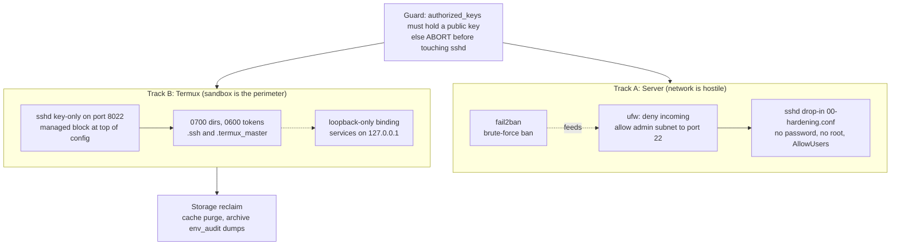

# Hardening Runbook - Baseline Security and Storage

Two environments, two trust models, two scripts. Do not cross-run them.

## 0. Why two tracks

- **Server:** the network is the hostile boundary, so the defenses are a
  firewall, fail2ban and sshd restrictions.
- **Termux:** the app sandbox is the boundary. There is no sudo, no systemd and
  no netfilter access. Defense shifts to file modes (0700/0600), key-only SSH on
  a high port, and loopback-only service binding. A service bound to 127.0.0.1
  cannot be reached from outside at all, which beats any firewall rule.



## 1. Control matrix

| Control | Server | Termux | Why |
|---|---|---|---|
| Package updates | `apt update && apt upgrade` | `pkg update && pkg upgrade` | Same intent, different managers |
| Firewall | ufw via `scripts/hardening-bootstrap.sh` | N/A, kernel netfilter is Android-owned | Sandbox replaces the network perimeter |
| Brute-force defense | fail2ban plus `MaxAuthTries 4` | key-only, high port, sandbox | No init system to host fail2ban |
| SSH config | `/etc/ssh/sshd_config.d/00-hardening.conf` | managed block at TOP of `$PREFIX/etc/ssh/sshd_config` | sshd is first-match-wins |
| SSH reload | `systemctl reload ssh` (never restart over SSH) | run `sshd` by hand, `pkill sshd` to reconfigure | reload keeps live sessions |
| Lockout guard | aborts unless a public key exists | aborts unless a public key exists | password auth off means no key, no entry |
| Storage | `/srv` layout | cache purge, audit-dump archiving | `/data` near full is the phone's emergency |
| Permissions | 700 appdata and backups, 750 media and shared | 700 `~/.termux_master`, 600 tokens | secrets on-device are the crown jewels |
| Audit dumps | n/a | archive, never delete | dumps can hold live tokens and evidence |

## 2. Run

```bash
# Server: as your normal admin user, with a second terminal already open
bash scripts/hardening-bootstrap.sh

# Termux
bash scripts/termux-hardening.sh
```

## 3. Verify

Server:

```bash
sudo sshd -T | grep -E "permitrootlogin|passwordauthentication|pubkeyauthentication|maxauthtries"
sudo ufw status verbose
sudo systemctl is-active fail2ban
```

Termux:

```bash
sshd -T | grep -E "passwordauthentication|pubkeyauthentication|maxauthtries"
df -h "$HOME"
ls -ld ~/.termux_master ~/tech-ref-portal ~/.ssh
ssh -p 8022 <user>@<pixel-ip>    # end to end, from another device
```

## 4. Rollback

| Failure | Recovery |
|---|---|
| Server: locked out of SSH | Keep the second terminal open until a fresh login works. Otherwise use the console and run `rm /etc/ssh/sshd_config.d/00-hardening.conf`, then reload ssh |
| Server: `PasswordAuthentication` still yes | Another config file wins. Inspect with `sshd -T` and look for earlier files in `sshd_config.d` |
| Termux: `sshd -t` fails | `cp $PREFIX/etc/ssh/sshd_config.bak $PREFIX/etc/ssh/sshd_config` |
| Audit dumps needed again | They are in `~/env-audit-archive`, never deleted |
